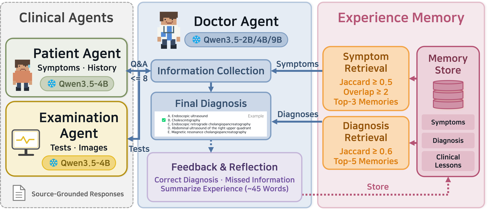
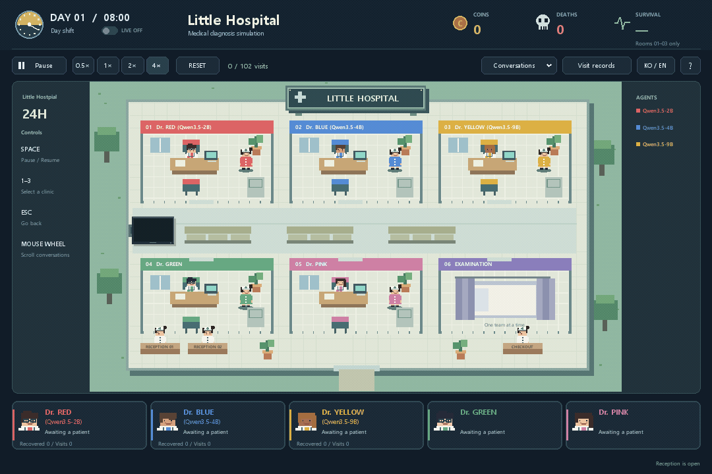

<div align="center">

# Little Hospital

**Development of a Memory-Based Self-Evolving Multi-Agent Learning Method and a Medical Diagnosis Simulation Environment**

[](https://www.python.org/)&nbsp;
[](https://pytorch.org/)&nbsp;
[](https://huggingface.co/docs/transformers/)&nbsp;
[](LICENSE)



</div>

---

## Overview

A diagnostic agent must decide what to ask and which examinations to request before choosing a diagnosis. Useful experience must transfer between patients without treating an earlier patient's findings as facts about the current patient.

**Little Hospital** pairs a multi-agent diagnosis workflow with a visual hospital simulation. The doctor stores lessons after completed encounters, recalls information-gathering advice by clinical presentation, and retrieves diagnostic notes using candidate disease names, without updating model weights.

## Paper

Submitted to the Korea Software Congress (KSC) 2026. Publication details will be added when available.

## Method

| Component | Function |
|:---:|---|
| Clinical environment | Releases only requested history and examination records within an action budget. |
| Doctor | Qwen3.5 2B, 4B, or 9B collects evidence, reasons over received images, and selects an answer. |
| Patient / examination router | 4B selects available history; 9B selects available examinations without interpreting their images. |
| `self` | Writes information-gathering lessons without an answer sheet. |
| `key` | Writes collection and diagnosis lessons after receiving the answer sheet; recalls collection lessons only. |
| `key_dx` | Adds diagnosis-note retrieval by all five candidate disease names. |
| Evaluation | Freezes memory, checks information boundaries, and replays recorded calls to audit each run. |

The inference pipeline uses local Hugging Face Transformers models. The desktop simulation replays saved encounters so that conversations, examinations, and patient movement can be inspected without loading model weights.

## Repository layout

```text
little-hospital/
├── clinical_memory/          # Importable implementation and command-line entry point
│   ├── data/                # Source download, curated-input preparation, splits, augmentation
│   ├── models/              # Transformers inference, role routing, generation seeds
│   ├── prompts/             # Doctor, patient, examination, reasoning and reflection templates
│   ├── environment/         # Encounter state, information boundaries and request guards
│   ├── memory/              # Notebook storage, presentation matching and diagnosis retrieval
│   ├── training/            # Main run loop, learning and crash-safe journal
│   ├── evaluation/          # Encounter execution and deterministic replay audit
│   ├── analysis/            # Paired comparisons, bootstrap intervals and reports
│   └── simulation/          # Desktop playback of final recorded encounters
├── assets/                  # Paper figure and simulation GIF
├── configs/                 # Dataset, model, experiment and simulation settings
├── resources/               # Curated reproduction inputs and simulation replay records
├── scripts/                 # Local launchers and Slurm jobs
├── tests/                   # Pipeline, data-integrity and simulation checks
├── LICENSES/                # Upstream dataset license and pinned dataset card
├── DATA.md                  # Dataset provenance, preparation and redistribution scope
├── RUNNING.md               # Individual runs, arrays, resume and analysis
└── SIMULATION.md            # Playback controls and custom result sources
```

## Getting started

### Installation

Use Python 3.11 and run the commands from the repository root. Simulation and CPU checks need only Pillow; the desktop window also needs Tk (included in standard Windows Python; `python3-tk` on many Linux distributions).

```bash
git clone https://github.com/dusdnKR/little-hospital.git
cd little-hospital
python -m venv .venv
# Linux/macOS: source .venv/bin/activate
# Windows PowerShell: .venv\Scripts\Activate.ps1
python -m pip install -r requirements.txt
python -m unittest discover -s tests -b
```

### Running the simulation



The GIF shows the simulation at **4× speed**. Start the same playback locally with the bundled encounter records; no model download, GPU, or network connection is needed.

```bash
python -m clinical_memory simulate --speed 4 --language en
python -m clinical_memory validate-simulation
```

Click a clinic to inspect its conversation and examination images. Space pauses or resumes playback; Escape returns to the hospital view. Windows users can also run `scripts/simulate.cmd --speed 4`. See [SIMULATION.md](SIMULATION.md) for custom replay sources, headless screenshots, and GIF export.

### Preparing data

The source is the multimodal subset of [MedXpertQA](https://huggingface.co/datasets/TsinghuaC3I/MedXpertQA), pinned by revision and SHA-256. Preparation checks the source against the included curated case files, keeps answer keys separate, and extracts the referenced images.

```bash
python -m clinical_memory download-data --download
python -m clinical_memory prepare-data
python -m clinical_memory split --write
python -m clinical_memory augment images
python -m clinical_memory augment build
python -m clinical_memory augment check
python -m clinical_memory check
```

See [DATA.md](DATA.md) for the curated input format, source checksums, split construction, and augmentation steps. Raw downloads and generated data are stored under `data/`.

### Installing the inference runtime and models

The inference runner requires exactly one visible NVIDIA A100 GPU and BF16 inference. Install the CUDA 11.8 runtime below on the inference machine. The patient and examination roles require Qwen3.5-4B and 9B even when the doctor is 2B; the download command fetches all three pinned model revisions.

```bash
python -m pip install -r requirements-inference.txt
python -m clinical_memory download-models
```

### Training and evaluation

For one condition, first complete a smoke run and its audit, then accumulate memory during training and evaluate the frozen notebook. `--doctor` selects `2B`, `4B`, or `9B`; `--learning` selects `self`, `key`, or `key_dx`; `--curriculum` selects `random`, `easy_to_hard`, or `hard_to_easy`.

```bash
python -m clinical_memory run --run-id cm_smoke_4b_key_dx --mode smoke --doctor 4B --learning key_dx
python -m clinical_memory audit --run-id cm_smoke_4b_key_dx
python -m clinical_memory run --run-id cm_4b_key_dx_random_s42 --mode train --doctor 4B --learning key_dx --curriculum random --seed 42
python -m clinical_memory audit --run-id cm_4b_key_dx_random_s42
python -m clinical_memory run --run-id cm_test1_4b_key_dx_random_s42_t302 --mode test --doctor 4B --learning key_dx --curriculum random --seed 42 --set test1 --step 302
python -m clinical_memory audit --run-id cm_test1_4b_key_dx_random_s42_t302
```

See [RUNNING.md](RUNNING.md) for baseline evaluations, Test 2, all 81 conditions, Slurm submission, and interrupted-run recovery.

### Analyzing runs

```bash
python -m clinical_memory analyze
python -m clinical_memory notebook --run-id cm_4b_key_dx_random_s42 --lessons 12
```

The report writes `results/summary.json` from completed audited runs. A paired comparison also requires the corresponding empty-notebook baseline. Generated runs, notebooks, and reports are excluded from Git.

## Related work

| | |
|---|---|
| **Clinical agents** | S. Schmidgall et al., "AgentClinic: a multimodal benchmark for tool-using clinical AI agents," *npj Digital Medicine*, 2026. ([Code](https://github.com/SamuelSchmidgall/AgentClinic)) — studies diagnosis through sequential patient interaction and examination requests. |
| **Self-evolving simulation** | M. Almansoori, K. Kumar, and H. Cholakkal, "Self-Evolving Multi-Agent Simulations for Realistic Clinical Interactions," *MICCAI*, 2025. ([Code](https://github.com/MAXNORM8650/MedAgentSim)) — explores experience reuse in simulated clinical interactions. |
| **Dataset** | Y. Zuo et al., "MedXpertQA: Benchmarking Expert-Level Medical Reasoning and Understanding," *ICML*, 2025. ([Code](https://github.com/TsinghuaC3I/MedXpertQA)) — provides the source questions, answer options, and medical images. |

## Acknowledgment

This implementation uses MedXpertQA, Qwen3.5, PyTorch, Hugging Face Transformers and Pillow. Dataset attribution and redistribution terms are recorded in [THIRD_PARTY_NOTICES.md](THIRD_PARTY_NOTICES.md).

## License

Released under the [MIT License](LICENSE). MedXpertQA-derived inputs and replay assets retain the upstream notices in [LICENSES](LICENSES); model weights are downloaded separately under their providers' terms, as described in [THIRD_PARTY_NOTICES.md](THIRD_PARTY_NOTICES.md).

## Citation

The manuscript is unpublished; a BibTeX entry will be added when its bibliographic details are available.
